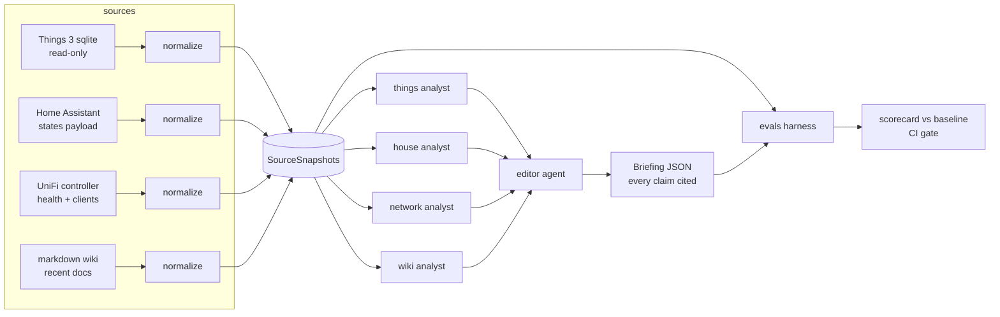

# reveille

A multi-agent morning-briefing coordinator with the part most agent demos skip: a scored,
regression-runnable evals harness over its own output.

Reveille pulls a task manager (Things 3), Home Assistant, a UniFi controller, and a
markdown wiki into one structured daily report. One analyst agent per source runs
concurrently, an editor agent merges their sections, and every claim in the final
briefing carries a citation back to a source entity. Then the evals suite grades the
result and fails CI if quality regresses.

## Why the evals half is the point

Anyone can chain LLM calls into a report. The hard question is the one production asks:
*did this run hallucinate, omit something urgent, leak a secret, or bloat past readability,
and would you know before your user did?* Reveille treats briefing quality like test
coverage:

| check | failure mode it catches | how |
|---|---|---|
| `schema` | output contract broken | pydantic validation of the raw JSON |
| `grounding` | hallucinated facts | every citation must resolve to a snapshot entity |
| `coverage` | urgent items silently dropped | overdue tasks, open doors, degraded subsystems must surface |
| `priorities` | sloppy triage | bounded, ordered, cited top priorities |
| `budget` | unreadable output | word/item caps per section |
| `hygiene` | secret leakage | secret-shaped string patterns in output |

All six are deterministic: no API key, no model in the loop, byte-for-byte reproducible.
A weighted scorecard is compared against a committed baseline; any drop beyond tolerance
exits nonzero, so a prompt tweak that quietly degrades grounding fails the build exactly
like a broken unit test.

```
| case         | schema | grounding | coverage | priorities | budget | hygiene | total    |
|--------------|--------|-----------|----------|------------|--------|---------|----------|
| golden       | 1.00   | 1.00      | 1.00     | 1.00       | 1.00   | 1.00    | **1.00** |
| hallucinated | 1.00   | 0.88      | 0.80     | 1.00       | 1.00   | 1.00    | **0.94** |
| shallow      | 1.00   | 1.00      | 0.20     | 1.00       | 1.00   | 1.00    | **0.87** |
| leaky        | 1.00   | 1.00      | 1.00     | 1.00       | 1.00   | 0.00    | **0.79** |
| bloated      | 1.00   | 1.00      | 1.00     | 1.00       | 0.50   | 1.00    | **0.95** |
| malformed    | 0.00   | 0.00      | 0.00     | 0.00       | 0.00   | 1.00    | **0.21** |
```

The degraded cases are committed fixtures, each a mechanical corruption of the golden
briefing targeting one failure mode. `tests/test_evals.py` asserts each one is caught by
the check aimed at it. The harness is proven to discriminate, not just to run.

An optional LLM-judge layer (`reveille evals --judge`) grades editorial quality on a
1-to-5 rubric (actionability, prioritization, concision). Judge scores are reported
alongside the deterministic total, never blended into it, so rubric drift can't mask a
grounding regression.

### Judge cache: reruns on unchanged inputs cost zero model calls

The judge is the only eval step that spends tokens, so it is the only step that is
cached. Each verdict is stored on disk under a content hash, and a rerun whose inputs
haven't changed reads the stored verdict instead of calling the model.

**The key** is sha256 over a canonical JSON serialization of everything that can change
the answer:

| key part | invalidates when |
|---|---|
| step id (`judge`) | another cached step is ever added |
| `JUDGE_VERSION` | scoring logic changes (parsing, validation, axes): bump the constant |
| rubric text | the rubric is edited at all |
| model id | the judge model changes |
| `max_tokens` | model params change |
| rendered briefing markdown | the fixture's judged content changes |

Change any one part and the key changes, so a stale verdict cannot be served. There is
no TTL, and nothing to flush by hand when a fixture, the rubric or the model changes.
The one manual step is bumping `JUDGE_VERSION` after editing the judge's own code.

**What is not cached, and why.** The six deterministic checks recompute on every run,
and a `--judge` run says so in one line (`skipped-deterministic`). They are pure functions over a small JSON
fixture: all 36 check cells (6 checks x 6 fixtures) run in about half a millisecond
(0.44 ms measured on a laptop, averaged over 200 runs, file reads included). Looking the
same 36 cells up in this cache, hash plus file read on a fully warm cache, measures
0.85 ms: about twice as slow as recomputing them. Caching would cost time and add the
one failure a CI gate can't afford, a stale score.

**The run report** shows a status per judge cell and a summary line:

```
cache: deterministic checks are skipped-deterministic (recomputed every run, never cached)
judge[golden] (miss): {"actionability": 4, "prioritization": 3, "concision": 5, ...}
judge[hallucinated] (hit): {...}
judge[malformed] (skipped): fails the schema, nothing to judge
...
judge: 1 hits, 4 misses, 1 skipped (4 model calls)
```

**Cost, from this repo's own fixtures.** There are 6 fixture briefings. One
(`malformed`) fails the schema and can't be rendered, leaving 5 judge cells; two of
those (`golden` and `hallucinated`) render to byte-identical markdown, because the
hallucinated source refs live in fields the markdown doesn't print.

| run | model calls |
|---|---|
| no cache (`--no-cache`), every run | 5 |
| cold cache | 4 (the identical pair shares one call) |
| warm rerun, nothing changed | **0** |
| warm rerun, one fixture's content edited | 1 |

Those 4 cold calls send 6,131 characters of rubric plus briefing, roughly 1,500 input
tokens at ~4 characters per token (an estimate; the repo has no tokenizer and pins no
price, so no dollar figure is claimed). The saving that matters is the call count.

**Flags and location.**

- `--no-cache` bypasses the cache entirely: no read, no write, every cell calls the model.
- `--clear-cache` deletes the cached verdicts, then runs as normal (so with `--judge` it
  is a forced refresh that repopulates the cache).
- The cache lives in `evals/judge_cache/` (gitignored); set `REVEILLE_CACHE_DIR` to move it.
- A corrupt, truncated or out-of-range cache file is a miss, never a crash, and the miss
  rewrites it. Only validated verdicts are stored, so a malformed model reply is never
  memoized.

**History.** A cached verdict whose scores match the case's latest row in
`evals/judge_history.sqlite` is not appended again, so reruns don't pad the trend with
duplicates. A fresh model call always records.

## Architecture



Design choices that carry the weight:

- **Snapshots and briefings are decoupled contracts.** The harness scores any
  `(snapshots, briefing)` pair regardless of who produced the briefing, which is what
  makes offline fixtures, regression baselines, and A/B-ing composers possible.
- **Citations are load-bearing.** Analysts must cite snapshot entity ids; the editor may
  only copy analyst items, never invent. Hallucination detection becomes a set-membership
  check instead of a judgment call.
- **A deterministic composer ships next to the LLM path.** `reveille brief --offline`
  builds the briefing with rules instead of models. It keeps CI key-free, generates the
  golden fixtures, and sets the floor the LLM path has to beat.
- **Cheap models where cheap works.** Analysts run on Haiku, the editor on Sonnet, and
  malformed JSON gets one repair retry with the parse error fed back before failing loud.

## Quickstart

```bash
uv sync
uv run pytest                 # 54 tests, no network, no API key
uv run reveille evals         # score fixture briefings vs the committed baseline
uv run reveille brief --offline               # briefing from fixtures, no key needed
uv run reveille brief --live-things --offline # real read-only Things data (macOS)
ANTHROPIC_API_KEY=... uv run reveille brief   # full multi-agent path
uv run reveille serve --port 8420             # demo HTTP API, see below
```

Fixtures are synthetic. Nothing in the repo requires credentials, and the Things adapter
opens the database with sqlite `mode=ro`.

## Demo API

`reveille serve` runs a two-endpoint FastAPI app that backs the "run now" button on the
live dashboard ([bdavis.ai/reveille](https://bdavis.ai/reveille)):

| endpoint | what it does |
|---|---|
| `GET /api/briefing` | the most recent briefing, generating one on first request |
| `POST /api/run` | regenerate now |

Both always compose over `demo.demo_snapshots()` -- the same synthetic fixtures
`reveille brief --offline` uses -- so the process never touches a real credential or a
live source adapter, and is safe to expose publicly.

## Repo map

```
src/reveille/
  schema.py           # SourceSnapshot + Briefing contracts (pydantic)
  sources/            # one adapter per source, raw payload -> normalized snapshot
  coordinator.py      # analyst fan-out, editor fan-in, offline composer
  llm.py              # narrow backend seam (Anthropic client / test fake)
  demo.py             # the synthetic fixture snapshots the CLI, API, and evals all share
  api.py              # the two-endpoint demo API (`reveille serve`)
  evals/
    checks.py         # the six deterministic checks
    scorecard.py      # suite runner, markdown scorecard, baseline compare
    judge.py          # optional model-graded rubric
    cache.py          # content-hash cache for judge verdicts (local, gitignored)
    history.py        # judge-verdict sqlite side-store (local, gitignored)
fixtures/             # synthetic source payloads + golden/degraded briefing cases
evals/baseline.json   # committed scorecard baseline (the CI gate)
scripts/make_fixtures.py
scripts/scheduled-brief.sh   # cron/launchd entry point
contrib/launchd/             # macOS launchd example
tests/
```

## Live sources (optional)

Every source has a fixture path (the CI default) and a live path (opt-in flags):

```bash
uv run reveille brief --live-things                  # local Things sqlite (macOS)
HA_URL=https://homeassistant HA_TOKEN_CMD='op-read-serialized "op://Automation/Home Assistant Token/credential"' \
  uv run reveille brief --live-ha
UNIFI_URL=https://192.168.0.1 UNIFI_API_KEY_CMD='op-read-serialized "op://Automation/UniFi API Key/credential"' \
  uv run reveille brief --live-unifi
```

Credentials resolve from an env var directly (`HA_TOKEN`, `UNIFI_API_KEY`) or from a
command named in a `*_CMD` env var, whose stdout is the secret -- this repo never
hardcodes a secret manager. `HA_VERIFY_SSL=false` / `UNIFI_VERIFY_SSL=false` (default
true) skip TLS verification for a self-signed local controller/instance. `--live-*`
flags are independent of `reveille evals`, which always scores the committed fixtures.

## Running on a schedule

`scripts/scheduled-brief.sh [reveille brief flags]` wraps `reveille brief`, writes
dated markdown + a run log to `$REVEILLE_OUT_DIR` (default `~/reveille-briefings`),
and exits nonzero on failure so cron/launchd's own failure handling fires.
`contrib/launchd/com.reveille.daily.plist` is a macOS launchd example (7am daily); a
cron line (`0 7 * * * /path/to/reveille/scripts/scheduled-brief.sh --offline`) works
identically on Linux.

## Status and roadmap

Vertical slice complete: Things, Home Assistant, and UniFi are all live sources
end-to-end (fixture path for CI, opt-in `--live-*` flags for the real thing), the
evals harness gates on the committed baseline, a scheduled-run target exists for
cron/launchd, and judge verdicts accumulate in a local sqlite history
(`evals/judge_history.sqlite`) so editorial-quality trend is visible run over run.
The LLM path has been run end-to-end against a real key and eval-scored against the
offline composer: both hit 1.00 on every deterministic check, and the judge rubric
preferred the LLM path 8/15 vs 7/15 (better actionability and prioritization; offline
edges concision) -- see `docs/DECISIONS.md`. Next: wiki source live wiring (currently
fixture-only in the same way HA/UniFi were before this phase), a scorecard-total
history alongside the judge history.

## Provenance

Extracted from a private, agent-operated personal control plane (25+ typed agents running
tasks, home infra, and communications). Patterns here, like the tiered scoring cascade and
the deterministic-check-before-model-judgment split, come from tooling that triages a
2,000-item task database continuously. Design decisions are logged in
[docs/DECISIONS.md](docs/DECISIONS.md), tagged `[llm-synth]` where an LLM made the call.
