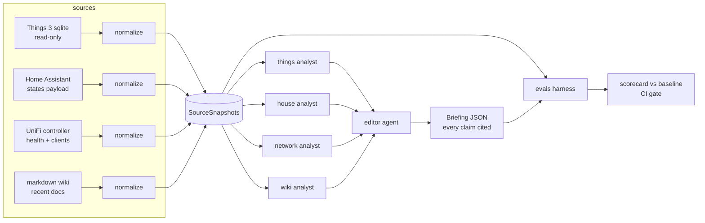

# reveille

A multi-agent morning-briefing coordinator with the part most agent demos skip: a scored,
regression-runnable evals harness over its own output.

Reveille pulls a task manager (Things 3), Home Assistant, a UniFi controller, and a
markdown wiki into one structured daily report. One analyst agent per source runs
concurrently, an editor agent merges their sections, and every claim in the final
briefing carries a citation back to a source entity. Then the evals suite grades the
result and fails CI if quality regresses.

## Why the evals half is the point

Anyone can chain LLM calls into a report. The hard question is the one production asks:
*did this run hallucinate, omit something urgent, leak a secret, or bloat past readability,
and would you know before your user did?* Reveille treats briefing quality like test
coverage:

| check | failure mode it catches | how |
|---|---|---|
| `schema` | output contract broken | pydantic validation of the raw JSON |
| `grounding` | hallucinated facts | every citation must resolve to a snapshot entity |
| `coverage` | urgent items silently dropped | overdue tasks, open doors, degraded subsystems must surface |
| `priorities` | sloppy triage | bounded, ordered, cited top priorities |
| `budget` | unreadable output | word/item caps per section |
| `hygiene` | secret leakage | secret-shaped string patterns in output |

All six are deterministic: no API key, no model in the loop, byte-for-byte reproducible.
A weighted scorecard is compared against a committed baseline; any drop beyond tolerance
exits nonzero, so a prompt tweak that quietly degrades grounding fails the build exactly
like a broken unit test.

```
| case         | schema | grounding | coverage | priorities | budget | hygiene | total    |
|--------------|--------|-----------|----------|------------|--------|---------|----------|
| golden       | 1.00   | 1.00      | 1.00     | 1.00       | 1.00   | 1.00    | **1.00** |
| hallucinated | 1.00   | 0.88      | 0.80     | 1.00       | 1.00   | 1.00    | **0.94** |
| shallow      | 1.00   | 1.00      | 0.20     | 1.00       | 1.00   | 1.00    | **0.87** |
| leaky        | 1.00   | 1.00      | 1.00     | 1.00       | 1.00   | 0.00    | **0.79** |
| bloated      | 1.00   | 1.00      | 1.00     | 1.00       | 0.50   | 1.00    | **0.95** |
| malformed    | 0.00   | 0.00      | 0.00     | 0.00       | 0.00   | 1.00    | **0.21** |
```

The degraded cases are committed fixtures, each a mechanical corruption of the golden
briefing targeting one failure mode. `tests/test_evals.py` asserts each one is caught by
the check aimed at it. The harness is proven to discriminate, not just to run.

An optional LLM-judge layer (`reveille evals --judge`) grades editorial quality on a
1-to-5 rubric (actionability, prioritization, concision). Judge scores are reported
alongside the deterministic total, never blended into it, so rubric drift can't mask a
grounding regression.

## Architecture



Design choices that carry the weight:

- **Snapshots and briefings are decoupled contracts.** The harness scores any
  `(snapshots, briefing)` pair regardless of who produced the briefing, which is what
  makes offline fixtures, regression baselines, and A/B-ing composers possible.
- **Citations are load-bearing.** Analysts must cite snapshot entity ids; the editor may
  only copy analyst items, never invent. Hallucination detection becomes a set-membership
  check instead of a judgment call.
- **A deterministic composer ships next to the LLM path.** `reveille brief --offline`
  builds the briefing with rules instead of models. It keeps CI key-free, generates the
  golden fixtures, and sets the floor the LLM path has to beat.
- **Cheap models where cheap works.** Analysts run on Haiku, the editor on Sonnet, and
  malformed JSON gets one repair retry with the parse error fed back before failing loud.

## Quickstart

```bash
uv sync
uv run pytest                 # 18 tests, no network, no API key
uv run reveille evals         # score fixture briefings vs the committed baseline
uv run reveille brief --offline               # briefing from fixtures, no key needed
uv run reveille brief --live-things --offline # real read-only Things data (macOS)
ANTHROPIC_API_KEY=... uv run reveille brief   # full multi-agent path
```

Fixtures are synthetic. Nothing in the repo requires credentials, and the Things adapter
opens the database with sqlite `mode=ro`.

## Repo map

```
src/reveille/
  schema.py           # SourceSnapshot + Briefing contracts (pydantic)
  sources/            # one adapter per source, raw payload -> normalized snapshot
  coordinator.py      # analyst fan-out, editor fan-in, offline composer
  llm.py              # narrow backend seam (Anthropic client / test fake)
  evals/
    checks.py         # the six deterministic checks
    scorecard.py      # suite runner, markdown scorecard, baseline compare
    judge.py          # optional model-graded rubric
fixtures/             # synthetic source payloads + golden/degraded briefing cases
evals/baseline.json   # committed scorecard baseline (the CI gate)
scripts/make_fixtures.py
tests/
```

## Status and roadmap

Vertical slice complete: Things is a live source end-to-end (real sqlite adapter,
schema-accurate synthetic tests), HA/UniFi run from recorded payloads through the same
normalizers their live fetchers use, and the evals harness gates on the committed
baseline. Next: live HA/UniFi fetch wiring, a scheduled run target, judge-score history
tracking.

## Provenance

Extracted from a private, agent-operated personal control plane (25+ typed agents running
tasks, home infra, and communications). Patterns here, like the tiered scoring cascade and
the deterministic-check-before-model-judgment split, come from tooling that triages a
2,000-item task database continuously. Design decisions are logged in
[docs/DECISIONS.md](docs/DECISIONS.md), tagged `[llm-synth]` where an LLM made the call.
